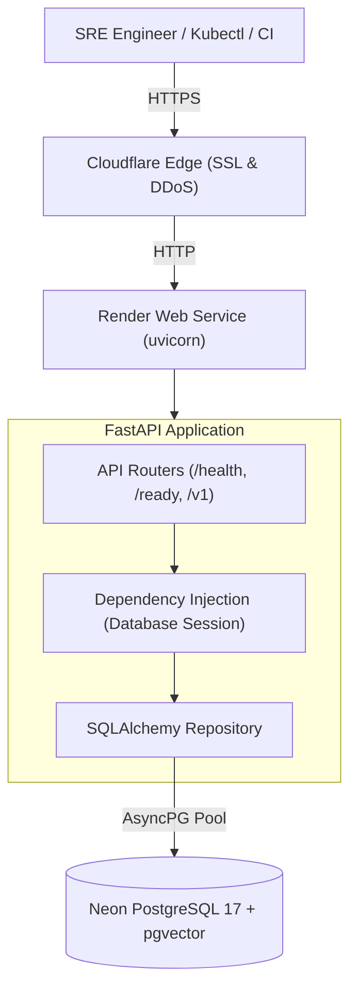

# System Architecture: KubeGuide

KubeGuide is an AI-assisted diagnostic assistant designed for Kubernetes site reliability engineers to troubleshoot incidents, version deprecations, and configuration drift.

---

## 1. High-Level Architecture

The service runs as a stateless containerized FastAPI application deployed on Render, backed by a serverless PostgreSQL instance with `pgvector` hosted on Neon.



---

## 2. Ingestion Subsystem

The corpus ingestion engine operates offline and scheduled, collecting upstream official Kubernetes documentation while obeying rate limits and site access policies.

```mermaid
flowchart LR
    Sources["data/sources.csv"] --> Downloader["Polite Downloader (fetch.py)"]
    Robots["robots.txt Check (RFC 9309)"] --> Downloader
    Downloader -->|Atomic Stream (.part)| RawCorpus["data/raw/"]
    Downloader -->|SHA256 Fingerprint| Manifest["data/manifest.jsonl"]
    Manifest --> Reporter["scripts/dataset_report.py"]
    Reporter --> DatasetMD["DATASET.md"]
    Reporter --> CapacityMD["docs/CAPACITY.md"]
```

---

## 3. Reliability & Probing Model

KubeGuide separates liveness and readiness to prevent cascading restarts during downstream outages:
* **`/health` (Liveness):** Confirms the HTTP server process is running and accepting event loop requests. Returns current Git SHA and environment status.
* **`/ready` (Readiness):** Performs an active `SELECT 1` query via AsyncPG against the PostgreSQL pool. If the database is unreachable, `/ready` returns HTTP 503, instructing ingress routers to drop traffic without restarting the container.
